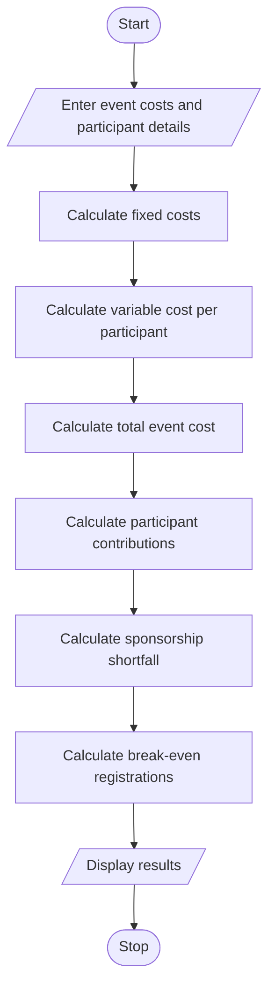

# Campus Event Financial Planning

## 1. Problem Statement

To write a Python program to calculate the total expenses of a campus event, including venue, equipment, catering, transport, and certificates. The program should calculate participant contributions, sponsorship shortfall, and the minimum number of registrations required to break even.

## 2. Algorithm

1. Start the program.
2. Enter venue cost.
3. Enter equipment cost.
4. Enter catering cost per participant.
5. Enter transport cost per participant.
6. Enter certificate cost per participant.
7. Enter expected participants, sponsorship amount, and registration fee per participant.
8. Calculate fixed costs (venue + equipment).
9. Calculate variable cost per participant.
10. Calculate total event cost.
11. Calculate total participant contributions.
12. Calculate sponsorship shortfall, if any.
13. Calculate minimum registrations required to break even.
14. Display all results.
15. Stop the program.

## 3. Flowchart


## 5. Sample Input

```
Enter venue cost: 10000
Enter equipment cost: 5000
Enter catering cost per participant: 200
Enter transport cost per participant: 50
Enter certificate cost per participant: 30
Enter expected number of participants: 100
Enter sponsorship amount: 10000
Enter registration fee per participant: 350
```

## 6. Sample Output

```
Minimum registrations needed: 72

--- CAMPUS EVENT FINANCIAL REPORT ---
Fixed Cost: 15000.0
Variable Cost per Participant: 280.0
Total Event Cost: 43000.0
Participant Contributions: 35000.0
Sponsorship Amount: 10000.0
Sponsorship Shortfall: 33000.0
Total Available Funds: 45000.0
Result: Event is financially successful.
```

