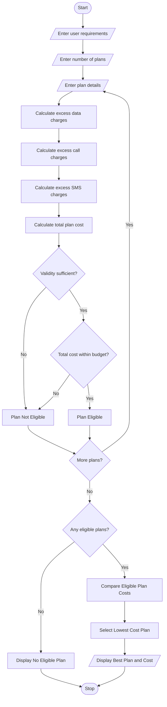

# 5. Multi-Plan Telecommunications Cost Optimization System

## 1. Problem Statement

The Multi-Plan Telecommunications Cost Optimization System is designed to compare different mobile recharge plans based on user requirements.

The system collects details such as data usage, call usage, SMS usage, plan validity, and budget. It calculates the total cost of each mobile plan, including excess usage charges when the user's consumption exceeds the plan limits.

It checks whether each plan satisfies the user's usage requirements, validity, and budget constraints. Finally, it identifies and displays the most economical eligible mobile plan.

## 2. Algorithm

Step 1: Start the program.

Step 2: Enter the number of mobile plans.

Step 3: Enter user requirements:

- Required data usage (GB).
- Required call minutes.
- Required SMS.
- Required validity (days).
- Maximum budget.

Step 4: Enter details of each mobile plan:

- Plan name.
- Plan cost.
- Included data.
- Included call minutes.
- Included SMS.
- Validity days.

Step 5: Calculate excess charges:

- Extra data charge = ₹10 per GB.
- Extra call charge = ₹1 per minute.
- Extra SMS charge = ₹0.50 per SMS.

Step 6: Calculate total plan cost including excess charges.

Step 7: Check validity and budget constraints.

Step 8: Identify eligible plans that satisfy all requirements.

Step 9: Compare the total costs of eligible plans.

Step 10: Select the plan with the lowest total cost.

Step 11: Display all plan details and the most economical plan.

Step 12: Stop the program.

## 3. Flowchart


## 5. Sample Input

```
===== MOBILE PLAN OPTIMIZATION =====

Enter required data (GB): 3
Enter required call minutes: 500
Enter required SMS: 100
Enter required validity days: 28
Enter maximum budget: 300

Enter number of mobile plans: 3

Enter details of Plan 1
Enter plan name: Basic
Enter plan cost: 199
Enter data limit (GB): 2
Enter call minutes: 500
Enter SMS limit: 100
Enter validity days: 28

Enter details of Plan 2
Enter plan name: Smart
Enter plan cost: 249
Enter data limit (GB): 3
Enter call minutes: 500
Enter SMS limit: 100
Enter validity days: 28

Enter details of Plan 3
Enter plan name: Premium
Enter plan cost: 349
Enter data limit (GB): 5
Enter call minutes: 1000
Enter SMS limit: 100
Enter validity days: 56
```

## 6. Sample Output

```
===== PLAN COMPARISON =====

Plan: Basic
Base Cost: Rs. 199.0
Excess Data Charge: Rs. 10.0
Excess Call Charge: Rs. 0.0
Excess SMS Charge: Rs. 0.0
Total Cost: Rs. 209.0

Plan: Smart
Base Cost: Rs. 249.0
Excess Data Charge: Rs. 0.0
Excess Call Charge: Rs. 0.0
Excess SMS Charge: Rs. 0.0
Total Cost: Rs. 249.0

Plan: Premium
Base Cost: Rs. 349.0
Excess Data Charge: Rs. 0.0
Excess Call Charge: Rs. 0.0
Excess SMS Charge: Rs. 0.0
Total Cost: Rs. 349.0

===== BEST MOBILE PLAN =====

Most Economical Plan: Smart
Total Cost: Rs. 249.0
Validity: 28 days

Plan Comparison Completed!
```

##
