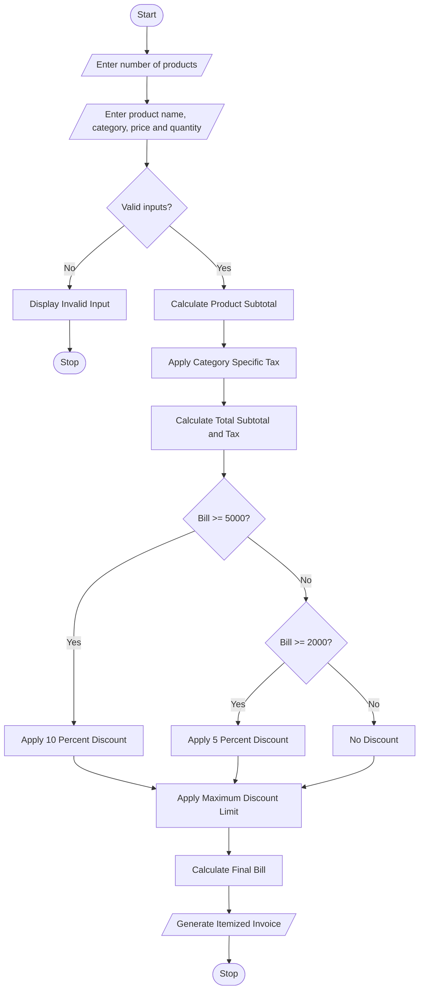

# 8. Retail Billing with Multiple Discount Rules

## 1. Problem Statement

The Retail Billing System is designed to generate an itemized invoice for customers purchasing multiple products.

The system collects product details such as product name, category, price, and quantity. It calculates the total price of each product and applies category-specific taxes.

It also applies threshold-based discounts depending on the total purchase amount and maintains a maximum concession limit to prevent excessive discounts.

Finally, the system calculates the total bill amount after discounts and taxes and generates an itemized invoice displaying product details, discounts, taxes, and the final payable amount.

## 2. Algorithm

Step 1: Start the program.

Step 2: Enter the number of products.

Step 3: Enter product details:

- Product name.
- Product category.
- Price per unit.
- Quantity.

Step 4: Calculate the subtotal for each product.

Subtotal = Price × Quantity.

Step 5: Apply category-specific taxes:

- Electronics: 18%.
- Clothing: 5%.
- Grocery: 0%.

Step 6: Calculate the total purchase amount.

Step 7: Apply threshold discounts:

- Bill amount ₹5,000 or above: 10% discount.
- Bill amount ₹2,000 or above: 5% discount.
- Below ₹2,000: No discount.

Step 8: Apply a maximum discount limit of ₹1,000.

Step 9: Calculate the final bill after discount and tax.

Step 10: Display the itemized invoice.

Step 11: Stop the program.

## 3. Flowchart



## 5. Sample Input

```
===== RETAIL BILLING SYSTEM =====

Enter number of products: 3

Product 1
Enter product name: Laptop
Enter category: electronics
Enter price per unit: 40000
Enter quantity: 1

Product 2
Enter product name: Shirt
Enter category: clothing
Enter price per unit: 1000
Enter quantity: 2

Product 3
Enter product name: Rice
Enter category: grocery
Enter price per unit: 500
Enter quantity: 2
```

## 6. Sample Output

```
========== ITEMIZED INVOICE ==========

Product: Laptop
Category: electronics
Price: 40000.0
Quantity: 1
Amount: 40000.0
Tax: 7200.0

Product: Shirt
Category: clothing
Price: 1000.0
Quantity: 2
Amount: 2000.0
Tax: 100.0

Product: Rice
Category: grocery
Price: 500.0
Quantity: 2
Amount: 1000.0
Tax: 0.0

-------------------------------------
Subtotal: Rs. 43000.0
Total Tax: Rs. 7300.0
Discount: Rs. 1000.0
Maximum Discount: Rs. 1000
-------------------------------------

Final Bill: Rs. 49300.0

=====================================
Thank you for shopping!
```

