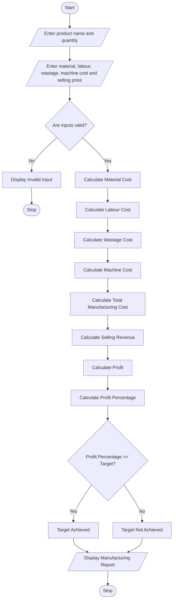

# 9. Manufacturing Cost and Profitability Analysis System

## 1. Problem Statement

The Manufacturing Cost and Profitability Analysis System is designed to calculate the total production cost and analyze the profitability of manufactured products.

The system collects details such as raw material cost, labour charges, wastage percentage, machine operating costs, production quantity, and selling price.

It calculates the total manufacturing cost by considering material costs, labour charges, wastage costs, and machine expenses.

It then calculates the selling revenue, total profit, and profit percentage. Finally, it checks whether the production meets the specified profit target and displays the profitability status.

## 2. Algorithm

Step 1: Start the program.

Step 2: Enter product name and production quantity.

Step 3: Enter the following details:

- Raw material cost per unit.
- Labour charge per unit.
- Wastage percentage.
- Machine cost per unit.
- Selling price per unit.
- Required profit percentage.

Step 4: Calculate total material cost.

Material Cost = Material Cost per Unit × Quantity.

Step 5: Calculate labour cost.

Labour Cost = Labour Charge per Unit × Quantity.

Step 6: Calculate wastage cost.

Wastage Cost = Material Cost × Wastage Percentage / 100.

Step 7: Calculate machine cost.

Machine Cost = Machine Cost per Unit × Quantity.

Step 8: Calculate total manufacturing cost.

Total Cost = Material Cost + Labour Cost + Wastage Cost + Machine Cost.

Step 9: Calculate total selling revenue.

Revenue = Selling Price per Unit × Quantity.

Step 10: Calculate total profit.

Profit = Revenue − Total Manufacturing Cost.

Step 11: Calculate profit percentage.

Profit Percentage = (Profit / Total Manufacturing Cost) × 100.

Step 12: Compare the profit percentage with the required profit target.

- If profit percentage is greater than or equal to the target, production meets the target.
- Otherwise, production does not meet the target.

Step 13: Display the manufacturing cost and profitability report.

Step 14: Stop the program.

## 3. Flowchart


## 5. Sample Input

```
===== MANUFACTURING COST ANALYSIS =====

Enter product name: Chair
Enter production quantity: 100
Enter material cost per unit: 500
Enter labour charge per unit: 150
Enter wastage percentage: 10
Enter machine cost per unit: 100
Enter selling price per unit: 900
Enter required profit percentage: 15
```

## 6. Sample Output

```
===== MANUFACTURING REPORT =====

Product Name: Chair
Production Quantity: 100

--------------------------------

Material Cost: Rs. 50000.0
Labour Cost: Rs. 15000.0
Wastage Cost: Rs. 5000.0
Machine Cost: Rs. 10000.0

--------------------------------

Total Manufacturing Cost: Rs. 80000.0
Selling Revenue: Rs. 90000.0
Total Profit: Rs. 10000.0
Profit Percentage: 12.5 %

--------------------------------

Required Profit Target: 15.0 %
Production Status: Profit Target Not Achieved

================================
Analysis Completed!
```

